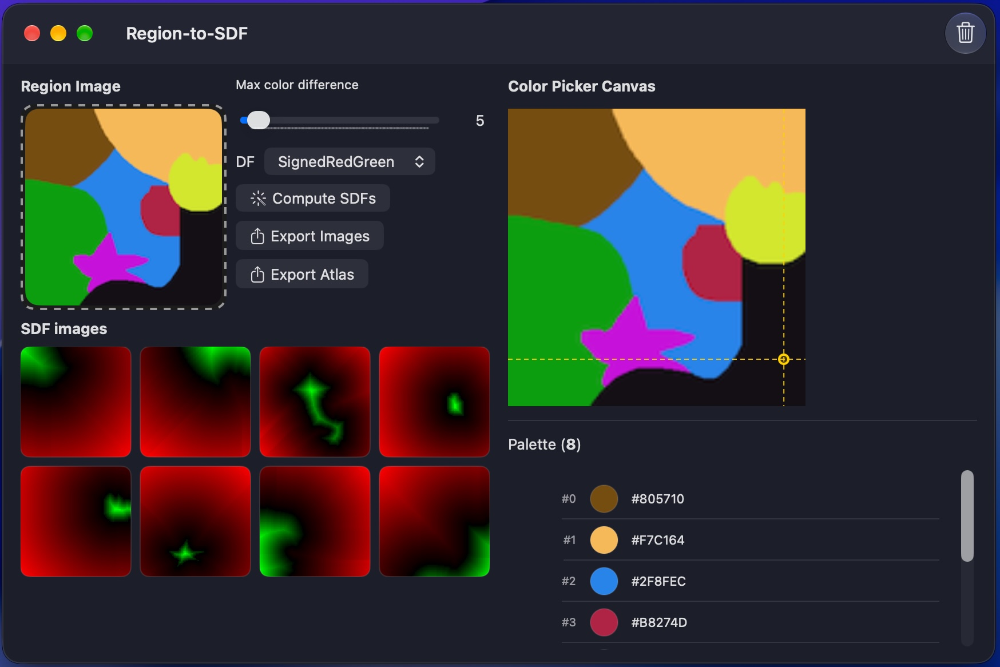

# Region to SDF

## Introduction
This is a tool to convert 2D images with clear boundaries (plain colors) to Signed Distance Fields and related representations.
## Build
It's written in Swift using SwiftUI. Use Xcode to build.

## Python DensityDF conversion

```sh
python3 -m pip install -r scripts/requirements.txt
python3 scripts/density_df.py Pictures/RegionTest128x128.png scripts/regions.example.json output.png
```

Edit `scripts/regions.example.json` with the colors to process. Colors accept `#RRGGBB`
or `[r, g, b]` integers. `epsilon` is Euclidean RGB distance in **0–255 channel
units**, inclusive; a region can override the global value (default 5).
Overlapping tolerances select the nearest eligible color, with ties resolved
in JSON order. Unmatched pixels create boundaries and are output as opaque black.
Alpha is ignored. To reproduce the app's nearest-color assignment for every
pixel, set `"matching": "nearest"` in JSON or add `--nearest`; this ignores epsilon.
Use `"matching": "tolerance"` (the default when omitted) to apply epsilon.

The sample JSON uses nearest matching and the dominant stored RGB colors of
`RegionTest128x128.png`; its output matches `RegionTest128x128_DF_expectation.png`
pixel for pixel. Color picker values can differ from stored pixels, so use the
image's raw RGB values for the palette. The script compares stored channels
without applying display color conversions. Nearest matching also assigns noisy
edge pixels, as the macOS app does; increasing epsilon alone does not reproduce
that behavior.

Run the tests with `cd scripts` then `python3 -m unittest -v test_density_df.py`.

The output is an RGBA PNG with red = distance / maximum distance for that region,
green = distance / image width, blue = 0, alpha = 255. Values are clamped to
0–1 and rounded to 8-bit channels. Disconnected areas assigned to the same
region share a maximum. Green decodes approximately as `G / 255 * image_width`
pixels; PNG quantization limits precision.

Like `MultiRegionalDF`, the script uses eight-neighbor Dijkstra distances
(orthogonal cost 1, diagonal cost √2), rather than a Euclidean distance transform.
Image edges count as boundaries; boundary pixels have positive distance 1,
or √2 when only a diagonal neighbor changes region. No mask growth is applied.
The heap implementation can take time on large images.

For use from Python, `densityAndDistanceFieldImage(rgb, config, nearest=False)`
returns a NumPy `uint8` RGBA array. `rgb` is an H×W×3 RGB array and `config` is
the parsed JSON dictionary.
